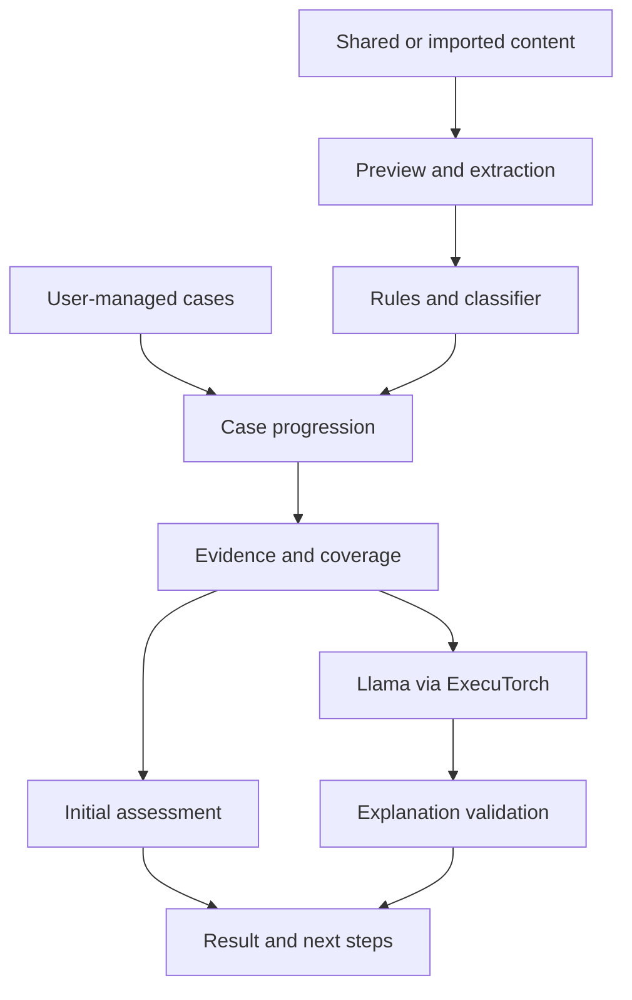

 

**Your phone. Your evidence. Your next step.**

An offline Android assistant for suspicious messages, links and payment requests.
Designed to explain the warning, show the evidence and connect the story.

**[Visit the website](https://nivoryn.vercel.app) · [Download the Android test APK](https://nivoryn.vercel.app/#download)**

Early-access version 0.2.0 · No account required.

[Why Nivoryn](#the-idea) · [Features](#features) · [Workflow](#how-it-works) · [Privacy](#privacy-and-boundaries) · [Architecture](#architecture) · [Development](#development) · [Roadmap](#roadmap)

> **Current status (2026-11-24):** version 0.2.0 reorganizes Home/Check/Activity/Settings, adds real camera capture and guided verified Llama/ExecuTorch setup. Local text/link, bundled OCR/QR, documents, PCAP replay, static APK inspection and encrypted history retain their real pipelines. Explicit downloads require connectivity; later analysis runs offline. Live usage shows aggregate byte totals only. Full PS3 readiness remains blocked by live intrusion detection, malware-behaviour coverage and physical-target validation. Read the [current evidence and readiness report](docs/reports/native-0.2.0/README.md).

[Offline implementation and security boundaries](docs/OFFLINE_IMPLEMENTATION.md)

[Run the frontend and review its boundaries](docs/frontend/README.md) · [Asset and font credits](docs/frontend/ASSETS.md)

---

## The idea

A message claims your parcel is held. A recruiter asks for a deposit. A payment request arrives with a convincing explanation.

Nivoryn is being built to help answer three practical questions:

**What looks suspicious? What is the evidence? What should I do next?**

The Android app combines local checks, a lightweight text classifier and Llama running through ExecuTorch. It explains available evidence and shows what remains unverified. Supported analysis works offline after the required model assets have been imported, with no cloud AI API or backend.

Built for **Bharat AI-SoC Challenge 2026–27 · PS3: On-device threat, phishing & scam detection**.

---

## Features

| Capability | Experience | Status |
| :--- | :--- | :--- |
| **Share to Check** | Share text or a link, or paste it manually. | Available |
| **Evidence cards** | Inspect the original phrase or URL detail behind a local warning. | Available |
| **Screenshot checks** | Read text with bundled OCR, correct it and check the confirmed text. | Latin/Devanagari and orientation tested in emulator |
| **QR inspection** | Decode a URL or payment payload without automatically opening it. | Available |
| **Visible uncertainty** | See which checks ran and what remains unverified. | Available |
| **Saved checks** | Deliberately save text, QR and exact evidence/advice snapshots in encrypted history; reopen, export or delete. | Verified in scoped host/emulator flows |
| **Scam Story** | Explore example timelines and related messages. | Authored examples; custom linking planned |
| **Local AI explanations** | Actual Llama / ExecuTorch generation, checked against findings and approved remediation. | Verified emulator; advisory reliability experimental |
| **Camera scan** | Capture with the Android camera or import, review real OCR/QR before analysis. | Implemented with permission/cancel/import alternatives |
| **Live usage** | Observe bounded device-wide byte totals with explicit start/stop. | Usage only; no destination threat detection or blocking |
| **Network replay** | Import bounded classic IPv4 PCAP and review flow/scan thresholds. | Host and Android provider tests; no live VPN |
| **APK indicators** | Inspect identity, permissions, signing fingerprints and static combinations without installation. | Android fixture tests; static only |

The website presents authored examples. The Android app runs scoped local services; neither certifies that content is safe. Cross-app notification reading, packet-level live threat inspection and broader case linking remain roadmap work.

---

## Scam Story

A scam may become clearer across several messages than it is in a single screenshot.

| Message | Possible evidence |
| :--- | :--- |
| “Part-time work available.” | An employment offer; insufficient evidence by itself. |
| “Join our group to start.” | A request to move the conversation elsewhere. |
| “Deposit ₹999 to release your earnings.” | An advance-payment demand tied to promised earnings. |

The planned case engine will connect user-selected messages, track relevant evidence and explain why a new message changes the assessment. Shared domains or payment identifiers may suggest a connection; uncertain associations will remain under user control.

**This is a proposed product distinction, not a claim of global novelty or proven detection superiority.**

---

## How it works

1. **Bring the content.** Share, paste or import a supported message, link or image.
2. **Review the input.** Check extracted text and correct OCR errors before analysis.
3. **Run local checks.** Parse URLs, apply reviewed rules and evaluate classifier signals.
4. **Add context.** Optionally attach the result to a user-managed case.
5. **Explain on device.** Ask Llama to explain the evidence through ExecuTorch.
6. **Choose an action.** Read curated verification steps, save the case or discard it.

### A result should be checkable

| Result field | Illustrative example |
| :--- | :--- |
| Assessment | **High risk** |
| Suspected pattern | Advance-fee / task-payment scam |
| Evidence | A deposit is requested before promised earnings can be released. |
| Next step | Pause the payment and independently verify the organisation. |
| Unverified | Sender identity and payment-recipient ownership. |

This is an example of the intended output, not a measured result from the current repository.

### Assessment labels

- **High risk:** strong, relevant warning evidence is available.
- **Suspicious:** warning signals exist, but evidence is incomplete or mixed.
- **No clear warning found:** available checks found no strong signal; this does not certify safety.
- **Cannot assess:** the input is insufficient, unreadable or unsupported.

---

## Architecture

The diagram describes the local pipeline. The reasoning model receives controlled finding facts and no browser, shell, messaging or payment tools. Generated explanations are checked against evidence references and approved actions; invalid output falls back to explicitly labelled curated guidance.

---

## Technology choices

| Layer | Selected approach |
| :--- | :--- |
| Android application | Kotlin + Jetpack Compose |
| Background work | Kotlin coroutines |
| On-device reasoning | Tested pinned Llama 3.2 1B Instruct, SpinQuant INT4 |
| Inference runtime | ExecuTorch Android 1.2.0, CPU/XNNPACK |
| Fast detection | Kotlin rules + exported lightweight text classifier |
| Classifier development | Reproducible Python multinomial Naive Bayes, with Kotlin parity checks |
| Screenshot extraction | Bundled ML Kit Latin / Devanagari OCR |
| QR decoding | ZXing |
| Saved checks / demo cases | Keystore AES-GCM store / app-private preferences |
| Remote backend / cloud AI | None; analysis runs inside the Android app |

Dependencies are locked in Gradle; see [API compatibility](docs/API_COMPATIBILITY.md), [resource setup](docs/MODEL_SETUP.md) and [validation](docs/PS3_VALIDATION.md). Published model conversion compatibility is emulator-verified; local source export and physical target verification remain pending.

<b>Model footprint and device measurements</b>

Meta reports a **1,083 MB PTE file** and **1,921 MB runtime RSS** for its 1B SpinQuant reference benchmark on OnePlus 12. These are reference measurements, not Nivoryn app benchmarks or minimum device requirements. See the [official model card](https://huggingface.co/meta-llama/Llama-3.2-1B-Instruct-SpinQuant_INT4_EO8).

The model uses a separate pinned guided download or advanced verified import. The tested pair needs about 1.14 GB before staging/previous-version overhead. Actual emulator load, generation, memory and frame samples are in the validation report; these are not physical-phone or battery measurements.

---

## Privacy and boundaries

The intended privacy model is straightforward: process locally, save deliberately and expose coverage clearly.

- No remote content analysis or cloud inference fallback.
- No automatic opening of suspicious URLs or payment payloads.
- No background upload of messages, screenshots or model inputs.
- Saved cases and attachments remain under user control.
- Backup behaviour, logging and dependency permissions must be audited before release.

An offline check cannot establish fresh domain registration details, live website reputation or payment-recipient ownership. A missing match is not evidence that something is safe.

Notification access does not provide complete chat history, and Android may redact sensitive content. Live cellular-call listening, universal payment blocking and complete antivirus protection are outside the initial release.

---

## Development

### What exists today

The repository contains a native Android app with real local services and a separately labelled authored demo. Current verification and measured results are recorded in the 0.2.0 report; historical test counts are retained with their original reports. Real OCR/QR, Llama inference, PCAP replay, APK static inspection and encrypted history are exercised. The spam proxy has a documented held-out UCI evaluation; it is not contemporary scam ground truth. The existing promotional website is preserved.

### Build and test

The website now distributes **Nivoryn-Guard-v0.2.0.apk**, a non-debuggable Arm64 preview. Build it with `zsh scripts/android.sh :app:assemblePreview`; the publication gate checks signature continuity, native 16 KB alignment and JNI class retention. See [installation guidance](docs/INSTALL_ANDROID.md) and [0.2.0 regression evidence](docs/reports/native-0.2.0/README.md). Android 17/API 37 with 16 KB pages passed 20 current device tests (18 offline model-required, 2 connected camera/usage) and an exact minified APK offline smoke. Oppo-specific installation remains unverified.

Use JDK 17, Android SDK 36 and the checked-in Gradle wrapper: `./gradlew :app:assembleDebug :app:assembleRelease :app:testDebugUnitTest :app:lintDebug`. `scripts/android.sh` uses the existing Mac/ORBIT toolchain where present. Resource-required instrumentation needs the documented real model staged first; no weights are test assets.

See [MODEL_SETUP](docs/MODEL_SETUP.md), [PHONE_ACCEPTANCE](docs/PHONE_ACCEPTANCE.md) and [PS3_VALIDATION](docs/PS3_VALIDATION.md). Older foundation reports retain their historical scope; the validation report supersedes their missing-model status.

### Repository layout

| Path | Responsibility |
| :--- | :--- |
| `app/src/main/java/dev/kyzenn/nivoryn/ui/` | Screens, shared components and theme |
| `.../domain/` | Analysis models and orchestration |
| `.../detection/` | URL checks, rules and classifier integration |
| `.../reasoning/` | Model import, ExecuTorch adapter and explanation validation |
| `.../data/` | Trusted model/rule state and encrypted history snapshots |
| `.../integration/` | Android share inputs and later optional integrations |
| `app/src/main/assets/` | Rules, approved actions and prompts |
| `tools/` | Model packaging and classifier development |
| `evaluation/` | Held-out fixtures and evaluation tooling |
| `docs/` | Setup, specification, provenance and measured benchmarks |

Model binaries, raw private datasets, signing keys and generated build outputs belong outside Git. The development plan keeps large resources on external storage and tests on a physical phone rather than requiring an emulator.

---

## Roadmap

- [x] Define the local-only Android architecture.
- [x] Create the repository and external-resource scaffold.
- [x] Configure a buildable Android project and real Gradle wrapper.
- [ ] Validate Llama + ExecuTorch on a physical Android device.
- [x] Implement bounded local text/link checks and evidence-based results.
- [x] Add validated local explanations and explicit fallback/cancellation handling (emulator verified).
- [ ] Implement Scam Story and user-controlled saved cases.
- [x] Add bundled screenshot OCR, editable correction and non-opening QR inspection (hardware verification pending).
- [ ] Evaluate optional notification checking.
- [x] Build a clearly labelled recorded-network-analysis demonstrator.
- [x] Record held-out spam-proxy evaluation, emulator profiles and an actual offline Llama demo; phone benchmarks pending.

Live VPN monitoring and behavioural malware detection are later work. Their absence must remain visible in the [PS3 coverage document](docs/PS3_COVERAGE.md); recorded analysis will not be described as live protection.

---

## Evaluation before claims

Detection results will be assessed against legitimate counterexamples and held-out scam cases, with separate reporting for language and scam category. Related templates, domains and conversations must not leak across training and test splits.

The evaluation plan includes false positives, precision/recall, explanation evidence validity, OCR failures, prompt injection, classifier parity and multi-message case errors. Device checks will cover cold loading, peak memory, repeated inference, missing assets, permission denial and airplane-mode operation.

**No detection accuracy, production readiness or complete PS3 coverage is claimed at this stage.**

---

## Documentation

[Project specification](docs/PROJECT_SPECIFICATION.md) · [Development setup](docs/SETUP.md) · [Model setup](docs/MODEL_SETUP.md) · [PS3 coverage](docs/PS3_COVERAGE.md) · [Data provenance](docs/DATA_PROVENANCE.md) · [Benchmarks](docs/BENCHMARKS.md)

The scaffold includes these documentation paths; detailed content will be populated alongside implementation.

---

## Contributing and licensing

Useful early contributions include reproducible Android integration, reviewed scam/legitimate examples, explanation-validation tests and device measurements. Do not include private messages, credentials, phone numbers or payment details in public issues or fixtures.

See [LICENSE](LICENSE) for the repository's current terms. Llama weights remain subject to the [Llama 3.2 Community License](https://github.com/meta-llama/llama-models/blob/main/models/llama3_2/LICENSE), independently of the application licence. Dependency and asset notices belong in [THIRD_PARTY_NOTICES.md](THIRD_PARTY_NOTICES.md).

---
---

## Contributors

| Name |
| :--- |
| **Harshit Raj** |
## References

- [Official Bharat AI-SoC Challenge and PS3](https://arm-education.github.io/Arm-Developer-Labs/Bharat_AI_SoC_2026_27.html)
- [ExecuTorch Android LLM documentation](https://github.com/pytorch/executorch/blob/main/docs/source/llm/run-on-android.md)
- [Official Llama 3.2 1B SpinQuant model card](https://huggingface.co/meta-llama/Llama-3.2-1B-Instruct-SpinQuant_INT4_EO8)
- [Android notification behaviour changes](https://developer.android.com/about/versions/15/behavior-changes-all)
- [Tesseract4Android](https://github.com/adaptech-cz/Tesseract4Android) · [ZXing](https://github.com/zxing/zxing)

---

**Nivoryn** · Check before you trust.

Designed for local processing, visible evidence and informed decisions.

