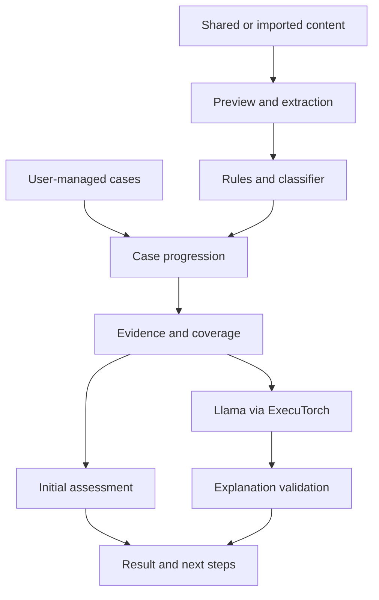

 

**Your phone. Your evidence. Your next step.**

An offline Android assistant for suspicious messages, links and payment requests.
Designed to explain the warning, show the evidence and connect the story.

**[Visit the website](https://nivoryn.vercel.app) · [Download the Android test APK](https://nivoryn.vercel.app/#download)**

Early-access version 0.1.1 · No account required.

[Why Nivoryn](#the-idea) · [Features](#features) · [Workflow](#how-it-works) · [Privacy](#privacy-and-boundaries) · [Architecture](#architecture) · [Development](#development) · [Roadmap](#roadmap)

> **Current status (2026-11-23):** the native Compose app now runs bounded local text rules, URL/payment-payload inspection, bundled Latin/Devanagari OCR and QR decoding. Explicitly saved text checks use encrypted, device-local history. Authored examples remain labelled separately. There is no Internet permission, remote backend, account or NIM integration. A scam classifier and Llama inference are **not** connected. Physical-phone validation remains pending.

[Offline implementation and security boundaries](docs/OFFLINE_IMPLEMENTATION.md)

[Run the frontend and review its boundaries](docs/frontend/README.md) · [Asset and font credits](docs/frontend/ASSETS.md)

---

## The idea

A message claims your parcel is held. A recruiter asks for a deposit. A payment request arrives with a convincing explanation.

Nivoryn is being built to help answer three practical questions:

**What looks suspicious? What is the evidence? What should I do next?**

The planned Android app combines local checks, a lightweight text classifier and Llama running through ExecuTorch. It will explain the available evidence and show what remains unverified. Core analysis is designed to work offline after the required model assets have been imported, with no cloud AI API or backend.

Built for **Bharat AI-SoC Challenge 2026–27 · PS3: On-device threat, phishing & scam detection**.

---

## Features

| Capability | Experience | Status |
| :--- | :--- | :--- |
| **Share to Check** | Share text or a link, or paste it manually. | Available |
| **Evidence cards** | Inspect the original phrase or URL detail behind a local warning. | Available |
| **Screenshot checks** | Read text with bundled OCR, correct it and check the confirmed text. | Available; Latin OCR tested in emulator |
| **QR inspection** | Decode a URL or payment payload without automatically opening it. | Available |
| **Visible uncertainty** | See which checks ran and what remains unverified. | Available |
| **Saved checks** | Deliberately save text in encrypted local history; review or delete it. | Available; export planned |
| **Scam Story** | Explore example timelines and related messages. | Authored examples; custom linking planned |
| **Local AI explanations** | Explain evidence through Llama / ExecuTorch. | Planned; not connected |

The website presents authored examples. The Android test build runs limited local checks; neither certifies that content is safe. Optional notifications and network analysis remain roadmap work.

---

## Scam Story

A scam may become clearer across several messages than it is in a single screenshot.

| Message | Possible evidence |
| :--- | :--- |
| “Part-time work available.” | An employment offer; insufficient evidence by itself. |
| “Join our group to start.” | A request to move the conversation elsewhere. |
| “Deposit ₹999 to release your earnings.” | An advance-payment demand tied to promised earnings. |

The planned case engine will connect user-selected messages, track relevant evidence and explain why a new message changes the assessment. Shared domains or payment identifiers may suggest a connection; uncertain associations will remain under user control.

**This is a proposed product distinction, not a claim of global novelty or proven detection superiority.**

---

## How it works

1. **Bring the content.** Share, paste or import a supported message, link or image.
2. **Review the input.** Check extracted text and correct OCR errors before analysis.
3. **Run local checks.** Parse URLs, apply reviewed rules and evaluate classifier signals.
4. **Add context.** Optionally attach the result to a user-managed case.
5. **Explain on device.** Ask Llama to explain the evidence through ExecuTorch.
6. **Choose an action.** Read curated verification steps, save the case or discard it.

### A result should be checkable

| Result field | Illustrative example |
| :--- | :--- |
| Assessment | **High risk** |
| Suspected pattern | Advance-fee / task-payment scam |
| Evidence | A deposit is requested before promised earnings can be released. |
| Next step | Pause the payment and independently verify the organisation. |
| Unverified | Sender identity and payment-recipient ownership. |

This is an example of the intended output, not a measured result from the current repository.

### Assessment labels

- **High risk:** strong, relevant warning evidence is available.
- **Suspicious:** warning signals exist, but evidence is incomplete or mixed.
- **No clear warning found:** available checks found no strong signal; this does not certify safety.
- **Cannot assess:** the input is insufficient, unreadable or unsupported.

---

## Architecture

The diagram describes the planned local pipeline. The reasoning model will not receive browser, shell, messaging or payment tools. Generated explanations will be checked against evidence references and approved actions; invalid output will fall back to a curated explanation.

---

## Technology choices

| Layer | Selected approach |
| :--- | :--- |
| Android application | Kotlin + Jetpack Compose |
| Background work | Kotlin coroutines |
| On-device reasoning | Llama 3.2 1B Instruct, SpinQuant INT4 candidate |
| Inference runtime | ExecuTorch |
| Fast detection | Kotlin rules + exported lightweight text classifier |
| Classifier development | Python / scikit-learn, with Kotlin parity checks |
| Screenshot extraction | Bundled ML Kit Latin / Devanagari OCR, without network permission |
| QR decoding | ZXing |
| Saved checks / demo cases | Keystore AES-GCM store / app-private preferences |
| Remote backend / cloud AI | None; analysis runs inside the Android app |

Android foundation dependencies are pinned in the Gradle build files; see [setup and verified commands](docs/SETUP.md). Model-export compatibility remains unverified.

<b>Model footprint and device measurements</b>

Meta reports a **1,083 MB PTE file** and **1,921 MB runtime RSS** for its 1B SpinQuant reference benchmark on OnePlus 12. These are reference measurements, not Nivoryn app benchmarks or minimum device requirements. See the [official model card](https://huggingface.co/meta-llama/Llama-3.2-1B-Instruct-SpinQuant_INT4_EO8).

The model is planned as a separate import rather than part of the APK. This reduces the APK download size, while the phone still needs storage for the imported assets. Actual APK size, whole-app memory use and inference latency remain unmeasured.

---

## Privacy and boundaries

The intended privacy model is straightforward: process locally, save deliberately and expose coverage clearly.

- No remote content analysis or cloud inference fallback.
- No automatic opening of suspicious URLs or payment payloads.
- No background upload of messages, screenshots or model inputs.
- Saved cases and attachments remain under user control.
- Backup behaviour, logging and dependency permissions must be audited before release.

An offline check cannot establish fresh domain registration details, live website reputation or payment-recipient ownership. A missing match is not evidence that something is safe.

Notification access does not provide complete chat history, and Android may redact sensitive content. Live cellular-call listening, universal payment blocking and complete antivirus protection are outside the initial release.

---

## Development

### What exists today

The repository contains a single Android app module with a genuine Gradle wrapper and a connected Compose demo frontend. Local rules, URL inspection, OCR, QR decoding and encrypted check history are implemented. A scam classifier, Llama model integration and held-out detection evaluation remain unimplemented. Bundled OCR models do not classify scams. See the frontend guide for implemented routes, state behaviour and verification limits.

### First engineering milestone

The Android foundation builds with `./gradlew :app:assembleDebug :app:lintDebug`. The screen shows “Check before you trust.”, “Android foundation ready” and “Local AI model: not configured”. No phone was connected during verification, so installation and launch remain untested.

See [docs/SETUP.md](docs/SETUP.md) for prerequisites, actual validation results, storage caveats and the device procedure. A later milestone will validate Llama through ExecuTorch on a physical Arm Android phone before integrating product features.

### Repository layout

| Path | Responsibility |
| :--- | :--- |
| `app/src/main/java/dev/kyzenn/nivoryn/ui/` | Screens, shared components and theme |
| `.../domain/` | Analysis models and orchestration |
| `.../detection/` | URL checks, rules and classifier integration |
| `.../reasoning/` | Model import, ExecuTorch adapter and explanation validation |
| `.../data/` | Model state; persistence will be added with saved cases |
| `.../integration/` | Android share inputs and later optional integrations |
| `app/src/main/assets/` | Rules, approved actions and prompts |
| `tools/` | Model packaging and classifier development |
| `evaluation/` | Held-out fixtures and evaluation tooling |
| `docs/` | Setup, specification, provenance and measured benchmarks |

Model binaries, raw private datasets, signing keys and generated build outputs belong outside Git. The development plan keeps large resources on external storage and tests on a physical phone rather than requiring an emulator.

---

## Roadmap

- [x] Define the local-only Android architecture.
- [x] Create the repository and external-resource scaffold.
- [x] Configure a buildable Android project and real Gradle wrapper.
- [ ] Validate Llama + ExecuTorch on a physical Android device.
- [x] Implement bounded local text/link checks and evidence-based results.
- [ ] Add validated local explanations and failure handling.
- [ ] Implement Scam Story and user-controlled saved cases.
- [x] Add bundled screenshot OCR, editable correction and non-opening QR inspection (hardware verification pending).
- [ ] Evaluate optional notification checking.
- [ ] Build a clearly labelled recorded-network-analysis demonstrator.
- [ ] Publish held-out evaluation, device benchmarks and an offline demo.

Live VPN monitoring and behavioural malware detection are later work. Their absence must remain visible in the [PS3 coverage document](docs/PS3_COVERAGE.md); recorded analysis will not be described as live protection.

---

## Evaluation before claims

Detection results will be assessed against legitimate counterexamples and held-out scam cases, with separate reporting for language and scam category. Related templates, domains and conversations must not leak across training and test splits.

The evaluation plan includes false positives, precision/recall, explanation evidence validity, OCR failures, prompt injection, classifier parity and multi-message case errors. Device checks will cover cold loading, peak memory, repeated inference, missing assets, permission denial and airplane-mode operation.

**No detection accuracy, production readiness or complete PS3 coverage is claimed at this stage.**

---

## Documentation

[Project specification](docs/PROJECT_SPECIFICATION.md) · [Development setup](docs/SETUP.md) · [Model setup](docs/MODEL_SETUP.md) · [PS3 coverage](docs/PS3_COVERAGE.md) · [Data provenance](docs/DATA_PROVENANCE.md) · [Benchmarks](docs/BENCHMARKS.md)

The scaffold includes these documentation paths; detailed content will be populated alongside implementation.

---

## Contributing and licensing

Useful early contributions include reproducible Android integration, reviewed scam/legitimate examples, explanation-validation tests and device measurements. Do not include private messages, credentials, phone numbers or payment details in public issues or fixtures.

See [LICENSE](LICENSE) for the repository's current terms. Llama weights remain subject to the [Llama 3.2 Community License](https://github.com/meta-llama/llama-models/blob/main/models/llama3_2/LICENSE), independently of the application licence. Dependency and asset notices belong in [THIRD_PARTY_NOTICES.md](THIRD_PARTY_NOTICES.md).

---

## References

- [Official Bharat AI-SoC Challenge and PS3](https://arm-education.github.io/Arm-Developer-Labs/Bharat_AI_SoC_2026_27.html)
- [ExecuTorch Android LLM documentation](https://github.com/pytorch/executorch/blob/main/docs/source/llm/run-on-android.md)
- [Official Llama 3.2 1B SpinQuant model card](https://huggingface.co/meta-llama/Llama-3.2-1B-Instruct-SpinQuant_INT4_EO8)
- [Android notification behaviour changes](https://developer.android.com/about/versions/15/behavior-changes-all)
- [Tesseract4Android](https://github.com/adaptech-cz/Tesseract4Android) · [ZXing](https://github.com/zxing/zxing)

---

**Nivoryn** · Check before you trust.

Designed for local processing, visible evidence and informed decisions.

